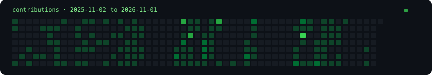

     

**The seven verified results:** [AIXI-Complexity](https://github.com/ajinkya-awari/aixi-complexity-benchmark) · [FedScope](https://github.com/ajinkya-awari/fedscope) · [GraphGPS-Upgrade](https://github.com/ajinkya-awari/graphgps-upgrade) · [ESM2-Protein-Fitness](https://github.com/ajinkya-awari/esm2-protein-fitness) · [AFBind](https://github.com/ajinkya-awari/afbind) · [F2-HistoGNN](https://github.com/ajinkya-awari/f2-histognn) · [SolomonoffBench](https://github.com/ajinkya-awari/solomonoff-bench). A partial real run, [PrivacyFL-DP](https://github.com/ajinkya-awari/privacyfl-dp), is in the ledger below. **The three negative results, published on purpose:** KnetMiner-LLM (strict acceptance 0/30), PrivacyFL-DP (chance-level AUC 0.497) and AIXI-Complexity (no difficulty proxy stays significant).

**Open to ML Engineering, Biomedical AI, Research Engineering, Responsible AI and Research Assistant opportunities in the UK.**

I am an **ML Engineer** pursuing an **MSc in Artificial Intelligence for Biomedicine and Healthcare at University College London (UCL), London, UK**.

Most ML portfolios show what worked. Mine shows what was **measured**, including the runs that came back near chance. Each project starts with leakage-safe splits, frozen budgets and a synthetic test layer, and touches real data only once access, licence and privacy gates are cleared. If a result is weak, the README says so on the first screen.

## Research areas

<table>
<thead>
<tr>
<th width="25%" align="left">Area</th>
<th width="75%" align="left">What I build</th>
</tr>
</thead>
<tbody>
<tr>
<td valign="top" align="left"><b>Reliable ML / MLOps</b></td>
<td valign="top" align="left">Reproducible training pipelines, leakage-safe splits, experiment tracking, versioned inference</td>
</tr>
<tr>
<td valign="top" align="left"><b>Biomedical AI</b></td>
<td valign="top" align="left">Graph neural networks for pathology, protein fitness, clinical retrieval, ICD coding</td>
</tr>
<tr>
<td valign="top" align="left"><b>Evaluation and safety</b></td>
<td valign="top" align="left">Agent-trace evaluation, medical-LLM safety contracts, XAI benchmarks</td>
</tr>
<tr>
<td valign="top" align="left"><b>Privacy and federated learning</b></td>
<td valign="top" align="left">Differential-privacy contracts, federated baselines, privacy-boundary testing</td>
</tr>
<tr>
<td valign="top" align="left"><b>Interpretability</b></td>
<td valign="top" align="left">Mechanistic attribution, activation capture, structured intervention tests</td>
</tr>
</tbody>
</table>

## The journey

## Case file: the evidence ledger

Status key: ✅ verified result · 🟡 measured, weak or partial · ⛔ documented gap

<table>
<thead>
<tr>
<th width="21%" align="left">Project</th>
<th width="59%" align="left">What was measured</th>
<th width="20%" align="center">Status</th>
</tr>
</thead>
<tbody>
<tr>
<td valign="top" align="left"><b><ins>AIXI-Complexity</ins></b></td>
<td valign="top" align="left">5 agent types on 20 frozen finite-state tasks. 81 tests, CI green. No difficulty proxy stays significant after Holm correction (min adjusted p = 0.144).</td>
<td valign="top" align="center">✅ <a href="https://github.com/ajinkya-awari/aixi-complexity-benchmark">↗</a></td>
</tr>
<tr>
<td valign="top" align="left"><b><ins>FedScope</ins></b></td>
<td valign="top" align="left">FedAvg, FedProx and FedNova against a centralized baseline. F1 0.78–0.80 over 3 seeds.</td>
<td valign="top" align="center">✅ <a href="https://github.com/ajinkya-awari/fedscope">↗</a></td>
</tr>
<tr>
<td valign="top" align="left"><b><ins>GraphGPS-Upgrade</ins></b></td>
<td valign="top" align="left">Frozen 30-epoch budget on a Tesla T4. Test ROC-AUC: GPS 0.748, GIN 0.698, GCN 0.693 (3 seeds).</td>
<td valign="top" align="center">✅ <a href="https://github.com/ajinkya-awari/graphgps-upgrade">↗</a></td>
</tr>
<tr>
<td valign="top" align="left"><b><ins>ESM2-Protein-Fitness</ins></b></td>
<td valign="top" align="left">Protein mutation fitness from ESM2 embeddings. 112 tests passing, Kaggle kernel run complete.</td>
<td valign="top" align="center">✅ <a href="https://github.com/ajinkya-awari/esm2-protein-fitness">↗</a></td>
</tr>
<tr>
<td valign="top" align="left"><b><ins>PrivacyFL-DP</ins></b></td>
<td valign="top" align="left">Real NIH ChestX-ray14, 5 federated clients, Opacus. 1 of 6 operating points measured: ε = 0.096, macro-AUC 0.497, which is chance level. Five pending; not yet independently reviewed. Reported as is.</td>
<td valign="top" align="center">🟡 <a href="https://github.com/ajinkya-awari/privacyfl-dp">↗</a></td>
</tr>
<tr>
<td valign="top" align="left"><b><ins>KnetMiner-LLM</ins></b></td>
<td valign="top" align="left">Evidence-grounded biomedical graph retrieval. Release engineering complete, but strict per-answer acceptance is <b>0/30</b>. <a href="https://ajinkya-awari.github.io/knetminer-llm/demo/">Live demo</a>.</td>
<td valign="top" align="center">⛔ <a href="https://github.com/ajinkya-awari/knetminer-llm">↗</a></td>
</tr>
</tbody>
</table>

## All 21 projects, 00 to 20

`🧪` means the contract and test layer is verified on synthetic data only. It is not a claim about real data.

### Reliable ML and MLOps

<table>
<thead>
<tr>
<th width="5%" align="center">#</th>
<th width="19%" align="left">Project</th>
<th width="39%" align="left">What it does</th>
<th width="37%" align="left">Evidence and limits</th>
</tr>
</thead>
<tbody>
<tr>
<td valign="top" align="center">00</td>
<td valign="top" align="left"><b><ins>SolomonoffBench</ins></b></td>
<td valign="top" align="left">Tests whether LLMs compress sequences the way an ideal predictor would, using sequences of known, varying algorithmic complexity.</td>
<td valign="top" align="left"><a href="https://github.com/ajinkya-awari/solomonoff-bench">↗</a> ✅ Benchmark slice closed; complexity-vs-compression analysis complete. Limits listed in the README.</td>
</tr>
<tr>
<td valign="top" align="center">01</td>
<td valign="top" align="left"><b><ins>T1 MLOps Stack</ins></b></td>
<td valign="top" align="left">An end-to-end ML pipeline: reproducible training, experiment tracking and a deployed inference app, covering the path from notebook to served model.</td>
<td valign="top" align="left"><a href="https://github.com/ajinkya-awari/t1-mlops-stack">↗</a> 🟡 Core pipeline complete. Deployment evidence is historical and due for re-verification.</td>
</tr>
<tr>
<td valign="top" align="center">02</td>
<td valign="top" align="left"><b><ins>T2 XAI Triple</ins></b></td>
<td valign="top" align="left">Compares Grad-CAM, SHAP and Integrated Gradients on NIH ChestX-ray14 and scores how well each explanation overlaps the annotated finding.</td>
<td valign="top" align="left"><a href="https://github.com/ajinkya-awari/xai-medical-imaging-project-02">↗</a> 🟡 Mean IoU 0.1289, so overlap is weak. Reported as measured; research use only.</td>
</tr>
<tr>
<td valign="top" align="center">03</td>
<td valign="top" align="left"><b><ins>AgentTrace</ins></b></td>
<td valign="top" align="left">An evaluation harness for LLM agent tool-call traces, with probes for sycophancy and reasoning-effort effects.</td>
<td valign="top" align="left"><a href="https://github.com/ajinkya-awari/agentrace">↗</a> ⛔ Implementation complete. Live runs are blocked by provider rate limits, so no live results are claimed.</td>
</tr>
<tr>
<td valign="top" align="center">12</td>
<td valign="top" align="left"><b><ins>GraphGPS-Upgrade</ins></b></td>
<td valign="top" align="left">Compares the GraphGPS graph transformer with GCN and GIN under one frozen 30-epoch budget on a Tesla T4, so gaps come from the model and not from extra tuning.</td>
<td valign="top" align="left"><a href="https://github.com/ajinkya-awari/graphgps-upgrade">↗</a> ✅ Test ROC-AUC: GPS 0.748, GIN 0.698, GCN 0.693 (3 seeds). Holds for this frozen recipe only.</td>
</tr>
</tbody>
</table>

### Biomedical and protein intelligence

<table>
<thead>
<tr>
<th width="5%" align="center">#</th>
<th width="19%" align="left">Project</th>
<th width="39%" align="left">What it does</th>
<th width="37%" align="left">Evidence and limits</th>
</tr>
</thead>
<tbody>
<tr>
<td valign="top" align="center">04</td>
<td valign="top" align="left"><b><ins>AFBind</ins></b></td>
<td valign="top" align="left">Tests whether AlphaFold2-predicted structures help predict protein-ligand binding affinity, using BindingDB Ki values and a leakage-safe cross-target split.</td>
<td valign="top" align="left"><a href="https://github.com/ajinkya-awari/afbind">↗</a> ✅ ECFP6 baseline Pearson r = 0.4765; 37 tests pass. The baseline is the reference point, not an AF2 comparison claim.</td>
</tr>
<tr>
<td valign="top" align="center">06</td>
<td valign="top" align="left"><b><ins>KnetMiner-LLM</ins></b></td>
<td valign="top" align="left">Answers biomedical questions over a knowledge graph with strict citations and abstention, evaluated with leakage-safe heterogeneous-graph splits.</td>
<td valign="top" align="left"><a href="https://github.com/ajinkya-awari/knetminer-llm">↗</a> ⛔ Release complete, but strict per-answer acceptance is 0/30 with the local model.</td>
</tr>
<tr>
<td valign="top" align="center">07</td>
<td valign="top" align="left"><b><ins>F2-HistoGNN</ins></b></td>
<td valign="top" align="left">Turns histology images into nuclei graphs and compares graph models on lung adenocarcinoma vs squamous (LUAD/LUSC) classification.</td>
<td valign="top" align="left"><a href="https://github.com/ajinkya-awari/f2-histognn">↗</a> ✅ 62 tests; real-data pilot with 4 models × 3 seeds. Pilot-sized, not clinical validation.</td>
</tr>
<tr>
<td valign="top" align="center">15</td>
<td valign="top" align="left"><b><ins>ESM2-Protein-Fitness</ins></b></td>
<td valign="top" align="left">Predicts how protein mutations change fitness, from ESM2 language-model embeddings.</td>
<td valign="top" align="left"><a href="https://github.com/ajinkya-awari/esm2-protein-fitness">↗</a> ✅ 112 tests; Kaggle run complete. Full-assay confidence intervals are optional follow-up.</td>
</tr>
<tr>
<td valign="top" align="center">18</td>
<td valign="top" align="left"><b><ins>OmicsGraph</ins></b></td>
<td valign="top" align="left">Pipeline contracts for single-cell omics graph learning: provenance, leakage and schema checks that must pass before real data is joined.</td>
<td valign="top" align="left"><a href="https://github.com/ajinkya-awari/omicsgraph">↗</a> 🧪 Synthetic scope verified. Real data waits on source licence and annotation review.</td>
</tr>
</tbody>
</table>

### Clinical systems and safety

<table>
<thead>
<tr>
<th width="5%" align="center">#</th>
<th width="19%" align="left">Project</th>
<th width="39%" align="left">What it does</th>
<th width="37%" align="left">Evidence and limits</th>
</tr>
</thead>
<tbody>
<tr>
<td valign="top" align="center">08</td>
<td valign="top" align="left"><b><ins>ClinicalBERT-ICD</ins></b></td>
<td valign="top" align="left">Multi-label ICD-9 coding, comparing LoRA with full fine-tuning, using patient-grouped splits and labels fitted on training data only.</td>
<td valign="top" align="left"><a href="https://github.com/ajinkya-awari/clinicalbert-icd">↗</a> 🧪 171 synthetic tests. The MIMIC-III benchmark awaits data-use approval.</td>
</tr>
<tr>
<td valign="top" align="center">09</td>
<td valign="top" align="left"><b><ins>NHSCopilot-Eval</ins></b></td>
<td valign="top" align="left">An evaluation harness for NHS-style AI assistant workflows, with scoring contracts that run without any provider or patient data.</td>
<td valign="top" align="left"><a href="https://github.com/ajinkya-awari/-nhscopilot-eval">↗</a> 🧪 33 public tests. Makes no clinical or NHS-endorsement claims.</td>
</tr>
<tr>
<td valign="top" align="center">10</td>
<td valign="top" align="left"><b><ins>PubMedQA-LoRA</ins></b></td>
<td valign="top" align="left">Classifies PubMedQA evidence labels with QLoRA fine-tuning against zero-shot, using official split provenance, constrained outputs and a gated locked test set.</td>
<td valign="top" align="left"><a href="https://github.com/ajinkya-awari/pubmedqa-lora">↗</a> ⛔ Development evidence only. Remaining folds wait on GPU quota.</td>
</tr>
<tr>
<td valign="top" align="center">11</td>
<td valign="top" align="left"><b><ins>MedLLM-Safety</ins></b></td>
<td valign="top" align="left">Defines what a medical-LLM evaluation must check before any real model is involved, and tests those checks on synthetic cases.</td>
<td valign="top" align="left"><a href="https://github.com/ajinkya-awari/medllm-safety">↗</a> 🧪 63 tests. Real-model readiness is not claimed.</td>
</tr>
<tr>
<td valign="top" align="center">13</td>
<td valign="top" align="left"><b><ins>ClinVision</ins></b></td>
<td valign="top" align="left">A research-only contract layer for image-to-text workflows on licence-cleared imaging data, built to validate safety checks before a real model runs.</td>
<td valign="top" align="left"><a href="https://github.com/ajinkya-awari/clinvision">↗</a> 🧪 Synthetic only. MIMIC-CXR is blocked, so no clinical claims.</td>
</tr>
<tr>
<td valign="top" align="center">14</td>
<td valign="top" align="left"><b><ins>CausalClinical</ins></b></td>
<td valign="top" align="left">A benchmark design for estimating treatment effects from MIMIC-III with causal methods and explicit assumption review.</td>
<td valign="top" align="left">🗂 Planning only. Needs MIMIC-III data-use approval; no code or repo yet.</td>
</tr>
<tr>
<td valign="top" align="center">19</td>
<td valign="top" align="left"><b><ins>NICE-RAG</ins></b></td>
<td valign="top" align="left">A retrieval scaffold where every answer must cite its NICE guideline source.</td>
<td valign="top" align="left"><a href="https://github.com/ajinkya-awari/-nice-rag">↗</a> 🧪 151 tests; 5 CC BY 4.0 PMC records verified. NICE content itself is gated.</td>
</tr>
</tbody>
</table>

### Privacy and federated learning

<table>
<thead>
<tr>
<th width="5%" align="center">#</th>
<th width="19%" align="left">Project</th>
<th width="39%" align="left">What it does</th>
<th width="37%" align="left">Evidence and limits</th>
</tr>
</thead>
<tbody>
<tr>
<td valign="top" align="center">05</td>
<td valign="top" align="left"><b><ins>FedScope</ins></b></td>
<td valign="top" align="left">Benchmarks the federated algorithms FedAvg, FedProx and FedNova against a centralized baseline on the same task.</td>
<td valign="top" align="left"><a href="https://github.com/ajinkya-awari/fedscope">↗</a> ✅ F1 0.78–0.80 across 3 seeds.</td>
</tr>
<tr>
<td valign="top" align="center">17</td>
<td valign="top" align="left"><b><ins>PrivacyFL-DP</ins></b></td>
<td valign="top" align="left">Federated learning with differential privacy (Opacus) on NIH ChestX-ray14 across 5 clients, measuring how the privacy level affects accuracy.</td>
<td valign="top" align="left"><a href="https://github.com/ajinkya-awari/privacyfl-dp">↗</a> 🟡 Real execution partial: 1 of 6 operating points measured (ε = 0.096); chance-level utility (macro-AUC 0.497); five pending; not yet independently reviewed.</td>
</tr>
</tbody>
</table>

### Interpretability and theory

<table>
<thead>
<tr>
<th width="5%" align="center">#</th>
<th width="19%" align="left">Project</th>
<th width="39%" align="left">What it does</th>
<th width="37%" align="left">Evidence and limits</th>
</tr>
</thead>
<tbody>
<tr>
<td valign="top" align="center">16</td>
<td valign="top" align="left"><b><ins>Mech-Interp</ins></b></td>
<td valign="top" align="left">Toy-scale tooling for mechanistic interpretability: capture activations, attribute behaviour and test interventions, with explicit limits on what each result proves.</td>
<td valign="top" align="left"><a href="https://github.com/ajinkya-awari/mech-interp">↗</a> 🧪 Toy scale. Real-model research is the next step.</td>
</tr>
<tr>
<td valign="top" align="center">20</td>
<td valign="top" align="left"><b><ins>AIXI-Complexity</ins></b></td>
<td valign="top" align="left">Compares five agent types (random, tabular Q, an AIXI-inspired planner, a small local LLM and an exact oracle) on 20 frozen tasks as declared difficulty proxies change.</td>
<td valign="top" align="left"><a href="https://github.com/ajinkya-awari/aixi-complexity-benchmark">↗</a> ✅ 81 tests, CI green. No proxy stays significant after Holm correction (min adjusted p = 0.144).</td>
</tr>
</tbody>
</table>

## What I'm looking for

A **research fellowship, paid placement or role** that funds the next step: taking interpretability and evaluation from toy models to real ones, with the same habit of reporting exactly what the numbers say. My dissertation period (March to September 2027) is open for a placement.

If you work on reliable ML for biomedicine, protein or graph learning, privacy-preserving ML, or model evaluation, the fastest way to judge me is to open one repo above and read its Limitations section. Then [email me](mailto:ajinkya.awari.26@ucl.ac.uk).

## Contact

- **UCL email:** [ajinkya.awari.26@ucl.ac.uk](mailto:ajinkya.awari.26@ucl.ac.uk)
- **Same mailbox, alternate UCL address:** [ucab378@ucl.ac.uk](mailto:ucab378@ucl.ac.uk)
- **Elsewhere:** [LinkedIn](https://www.linkedin.com/in/ajinkya-awari-641114249) · [GitHub](https://github.com/ajinkya-awari) · [Hugging Face](https://huggingface.co/ajinkya1807) · [Kaggle](https://www.kaggle.com/ajinkya1225)

## Technologies

       

## GitHub activity

Calendar generated from GitHub's public contribution data. No JavaScript or tracking widgets.

## Published research

<table>
<thead>
<tr>
<th width="55%" align="left">Paper</th>
<th width="20%" align="left">Venue</th>
<th width="25%" align="left">DOI</th>
</tr>
</thead>
<tbody>
<tr>
<td valign="top" align="left">Plant Disease Detection using Machine Learning</td>
<td valign="top" align="left">IJARSCT, 2023</td>
<td valign="top" align="left"><a href="https://doi.org/10.48175/IJARSCT-9297">10.48175/IJARSCT-9297</a></td>
</tr>
<tr>
<td valign="top" align="left">Transfer Learning for Plant Disease Detection</td>
<td valign="top" align="left">IJARSCT, 2023</td>
<td valign="top" align="left"><a href="https://doi.org/10.48175/IJARSCT-9156">10.48175/IJARSCT-9156</a></td>
</tr>
</tbody>
</table>

<strong>Earlier experiments</strong> · the foundation, built Mar–Apr 2026 before the numbered portfolio

 

The numbered projects above grew out of these twelve experiments. They are where I learned to compare methods under one fixed budget and to report failures, which is the habit the portfolio is built on.

#### 👁️ Vision and transfer learning

<table>
<thead>
<tr>
<th width="20%" align="left">Project</th>
<th width="38%" align="left">What it explores</th>
<th width="42%" align="left">Method and evidence</th>
</tr>
</thead>
<tbody>
<tr>
<td valign="top" align="left"><b><ins>Transfer-Learning-Plant-Disease</ins></b></td>
<td valign="top" align="left">Extends my published IJARSCT 2023 study: VGG16 vs ResNet50 vs EfficientNetB0 on the PlantVillage leaf dataset.</td>
<td valign="top" align="left"><a href="https://github.com/ajinkya-awari/Transfer-Learning-Plant-Disease">↗</a> Documents a frozen-BatchNorm failure that collapses accuracy to about 14%, and the fix that restores about 99%.</td>
</tr>
<tr>
<td valign="top" align="left"><b><ins>ChestXplain</ins></b></td>
<td valign="top" align="left">Multi-label chest X-ray classification across 14 disease categories, with Grad-CAM heatmaps showing what the model looked at.</td>
<td valign="top" align="left"><a href="https://github.com/ajinkya-awari/xai-medical-imaging">↗</a> DenseNet121, two-phase transfer learning, Streamlit demo. Predecessor of T2 XAI Triple (02).</td>
</tr>
<tr>
<td valign="top" align="left"><b><ins>IoT Anomaly Detection</ins></b></td>
<td valign="top" align="left">Detecting five industrial fault types in IoT sensor streams.</td>
<td valign="top" align="left"><a href="https://github.com/ajinkya-awari/iot-anomaly-detection">↗</a> LSTM and Transformer autoencoders against an Isolation Forest, with attention visualisation.</td>
</tr>
</tbody>
</table>

#### 🕸️ Graph learning

<table>
<thead>
<tr>
<th width="20%" align="left">Project</th>
<th width="38%" align="left">What it explores</th>
<th width="42%" align="left">Method and evidence</th>
</tr>
</thead>
<tbody>
<tr>
<td valign="top" align="left"><b><ins>GNN Agricultural Networks</ins></b></td>
<td valign="top" align="left">How crop disease spreads across a network, modelled as a graph.</td>
<td valign="top" align="left"><a href="https://github.com/ajinkya-awari/gnn-agricultural-networks">↗</a> GCN, GraphSAGE and GAT in PyTorch Geometric, with an optimisation convergence analysis.</td>
</tr>
</tbody>
</table>

#### 🎮 Reinforcement learning and agents

<table>
<thead>
<tr>
<th width="20%" align="left">Project</th>
<th width="38%" align="left">What it explores</th>
<th width="42%" align="left">Method and evidence</th>
</tr>
</thead>
<tbody>
<tr>
<td valign="top" align="left"><b><ins>RL Autonomous Navigation</ins></b></td>
<td valign="top" align="left">Which learner copes best with a stochastic gridworld.</td>
<td valign="top" align="left"><a href="https://github.com/ajinkya-awari/rl-autonomous-navigation">↗</a> Tabular Q-learning, Double DQN and PPO on FrozenLake-v1: convergence, sample efficiency and animated policies.</td>
</tr>
<tr>
<td valign="top" align="left"><b><ins>Curious Adaptive Planner</ins></b></td>
<td valign="top" align="left">Whether curiosity helps a planner under bounded compute.</td>
<td valign="top" align="left"><a href="https://github.com/ajinkya-awari/curious-adaptive-planner">↗</a> Curiosity-augmented value iteration with adaptive policy arbitration.</td>
</tr>
<tr>
<td valign="top" align="left"><b><ins>Adaptive AI Monitoring</ins></b></td>
<td valign="top" align="left">Catching an RL agent that goes wrong during training.</td>
<td valign="top" align="left"><a href="https://github.com/ajinkya-awari/adaptive-ai-monitoring">↗</a> Detects reward hacking, entropy spikes and behavioural drift through KL divergence; includes a PID hardware loop.</td>
</tr>
<tr>
<td valign="top" align="left"><b><ins>LLM Reasoning Orchestrator</ins></b></td>
<td valign="top" align="left">Reducing LLM hallucination on engineering maths.</td>
<td valign="top" align="left"><a href="https://github.com/ajinkya-awari/llm-reasoning-orchestrator">↗</a> The LLM routes calculations to a SymPy solver for exact answers (neuro-symbolic).</td>
</tr>
</tbody>
</table>

#### 📐 Optimisation, algorithms and data

<table>
<thead>
<tr>
<th width="20%" align="left">Project</th>
<th width="38%" align="left">What it explores</th>
<th width="42%" align="left">Method and evidence</th>
</tr>
</thead>
<tbody>
<tr>
<td valign="top" align="left"><b><ins>NN Optimizer Study</ins></b></td>
<td valign="top" align="left">How optimisers differ on the same network.</td>
<td valign="top" align="left"><a href="https://github.com/ajinkya-awari/nn-optimizer-study">↗</a> SGD, Adam, RMSprop, Adagrad and L-BFGS on CIFAR-10, with gradient-norm tracking and loss-landscape plots.</td>
</tr>
<tr>
<td valign="top" align="left"><b><ins>Algorithm Complexity Visualizer</ins></b></td>
<td valign="top" align="left">Checking Big-O claims against measured behaviour.</td>
<td valign="top" align="left"><a href="https://github.com/ajinkya-awari/algorithm-complexity-visualizer">↗</a> Exact operation counts for four sorts and Dijkstra, log-log regression, PDF report and an interactive web visualiser.</td>
</tr>
<tr>
<td valign="top" align="left"><b><ins>Advanced DSA Patterns</ins></b></td>
<td valign="top" align="left">A reference library of algorithmic patterns.</td>
<td valign="top" align="left"><a href="https://github.com/ajinkya-awari/Advanced-DSA-Patterns">↗</a> 60+ patterns, each with automated tests.</td>
</tr>
<tr>
<td valign="top" align="left"><b><ins>Market Density Cloud</ins></b></td>
<td valign="top" align="left">Hidden structure across stocks, crypto and forex.</td>
<td valign="top" align="left"><a href="https://github.com/ajinkya-awari/market-density-cloud">↗</a> PCA and clustering with an interactive dashboard.</td>
</tr>
</tbody>
</table>

Ajinkya Awari · UCL MSc Artificial Intelligence for Biomedicine and Healthcare

